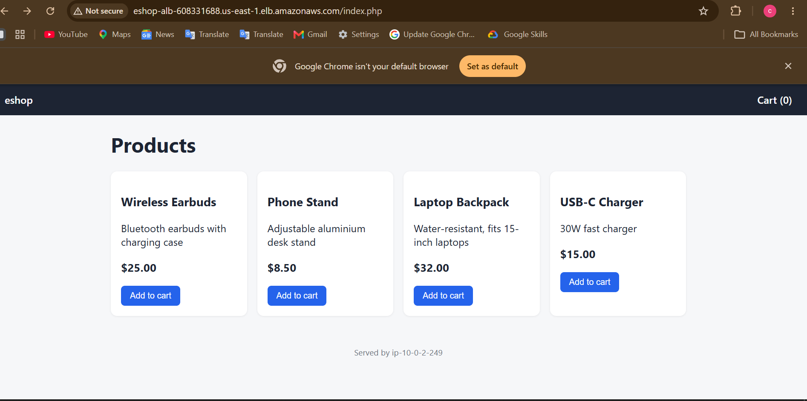
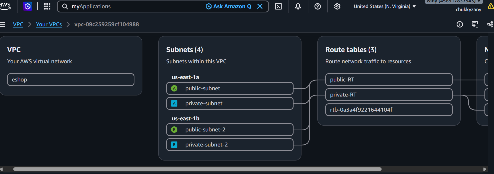
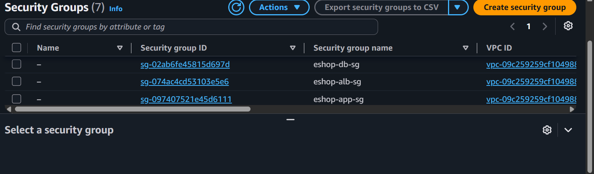
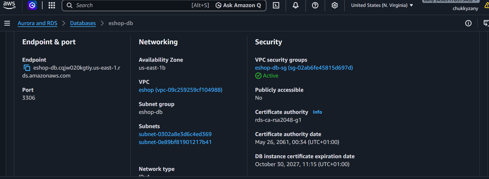
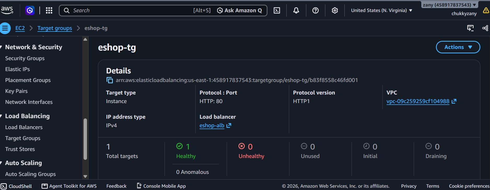
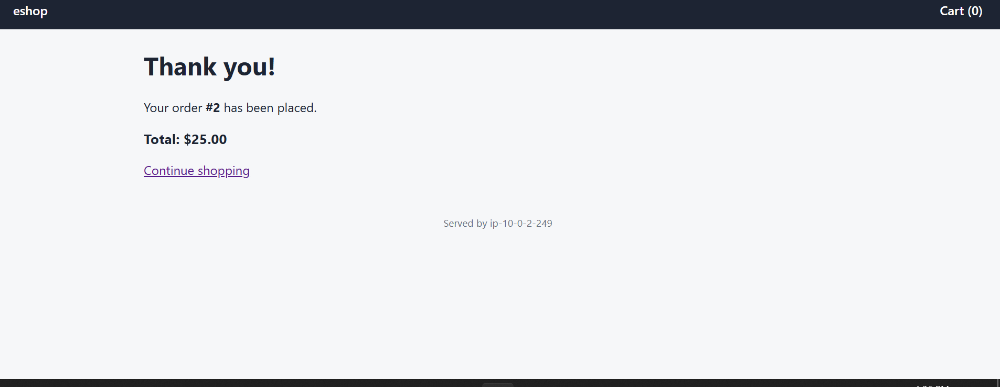
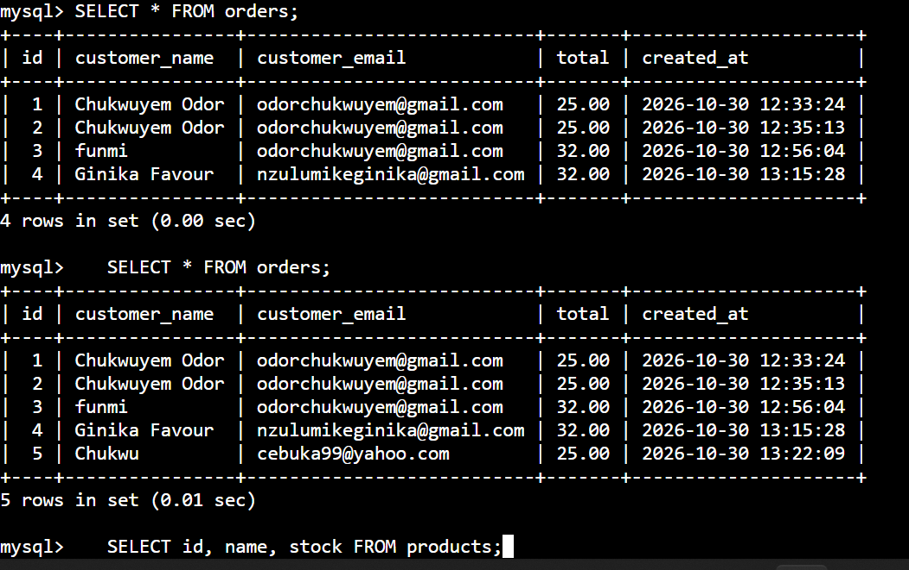

# zany-project: A Secure 3-Tier E-Commerce Platform on AWS

> A practice project built around a simulated business scenario, and built by hand in the AWS Console.

## The business problem

A small online retailer selling everyday accessories (earbuds, phone stands, chargers) has outgrown taking orders by chat. They need a proper online store, but they have three worries:

- **Customer data must be protected.** Orders and customer details can't be exposed to the internet.
- **The store has to stay reachable.** Customers shouldn't hit a dead page when traffic grows or one data centre has a problem.
- **They have no dedicated IT team.** Server access has to be secure and simple to manage, with no open admin ports to defend.

## The solution

I designed and built a 3-tier store on AWS that addresses each worry:

- **Protected data:** the database sits in private subnets with no public access, and the app connects to it over verified SSL. The only thing the internet can reach is the load balancer.
- **Built to grow:** the network spans two Availability Zones behind an Application Load Balancer, so adding a second server is a small step, not a redesign.
- **Safe, simple administration:** the server has no public IP and no SSH key. Admins connect through AWS Session Manager, so there's no open port to defend.

## What it delivers

- Customers can browse products, build a cart and check out as guests
- Every order is saved to the database in a single transaction that also updates stock
- Each layer only accepts traffic from the layer in front of it, using chained security groups



## How it fits together

A visitor's request travels like this:

```
Internet
   |
   v
Application Load Balancer (public subnets, two Availability Zones)
   |  HTTP on port 80
   v
EC2 server running Ubuntu, Apache and PHP (private subnet)
   |  MySQL on port 3306, over verified SSL
   v
RDS MySQL database (private subnets, not publicly accessible)
```

- **VPC (10.0.0.0/16):** my own private network, with two public and two private subnets spread across two Availability Zones.
- **Application Load Balancer:** the only public entry point. It checks that the server is healthy and passes traffic to it.
- **EC2 (Ubuntu Server 24.04):** runs the store. It sits in a private subnet with no public IP address.
- **RDS MySQL:** stores the products and orders. It's in private subnets and can't be reached from the internet.
- **NAT gateway:** lets the private server go out to the internet to install software, without letting anything in.
- **S3 gateway endpoint:** a free, private route from the private subnets to S3.
- **Session Manager:** how I log in to the server. There's no SSH key and no open SSH port.

## How I built it, step by step

### Step 1: The network

I created the VPC with two public and two private subnets across two Availability Zones, an internet gateway, and a NAT gateway. I used two route tables: the public one sends outbound traffic to the internet gateway, and the private one sends it to the NAT gateway, so the private server can install software without being reachable from the internet. I also added a free S3 gateway endpoint to the private route tables.



### Step 2: Security groups

I wanted every layer to only talk to the layer right in front of it, so I chained three security groups:

- **Load balancer group (`eshop-alb-sg`):** accepts web traffic (port 80) from anywhere.
- **App server group (`eshop-app-sg`):** accepts web traffic only from the load balancer.
- **Database group (`eshop-db-sg`):** accepts MySQL traffic (port 3306) only from the app server.



### Step 3: The database (RDS MySQL)

I made a DB subnet group from the two private subnets, then created the MySQL database with public access turned off and the database security group attached. It can only be reached from the app server.



### Step 4: The app server (EC2)

I launched an Ubuntu Server 24.04 instance in a private subnet, with no public IP, no key pair, and an IAM role for Session Manager. Its startup script, [`userdata.sh`](userdata.sh), installs Apache, PHP and the MySQL client and adds a simple health check page. Once it passed its status checks, I connected through Session Manager and confirmed Apache was running and the health page returned `OK`.

### Step 5: Connecting to the database

From the server, I logged in to the database over verified SSL, then created the `products`, `orders` and `order_items` tables and added some sample products.

### Step 6: Deploying the store

I ran [`deploy-app.sh`](deploy-app.sh) on the server. It asks for the database details and creates the PHP store. A quick test from the server showed the products coming back from the database.

### Step 7: Target group and load balancer

I created a target group with a health check on `/health.html` and registered the server. Then I created the internet-facing load balancer in the two public subnets, forwarding HTTP on port 80 to the target group. The server showed as healthy.



### Step 8: Testing the whole store

I opened the load balancer's address in my browser. The page loaded from the private server, which you can see in the "Served by" line at the bottom of the page. I added items to the cart, checked out as a guest, and the order went through. I then checked the database to make sure the order was saved and the stock went down.





## How I locked it down

- The server has no public IP and no key pair. I get a shell through Session Manager with an IAM role.
- The database has public access switched off.
- The security groups are chained, so each layer only accepts traffic from the layer in front of it.
- The app connects to the database over SSL and checks the server's certificate against the AWS RDS certificate bundle.
- The database password lives in a private folder outside the web root. It isn't in this repository and it isn't in the website files.
- The PHP code uses prepared statements for every query and escapes everything it prints.

## What the store does

- Shows a product list from the database
- Lets you add items to a cart, change quantities and remove items
- Offers guest checkout with just a name and email, so there are no accounts to manage
- Saves each order to the database in one transaction, which also checks and reduces the stock
- Shows a confirmation page with your order number and total

## Things that went wrong (and how I fixed them)

**"Permission denied" when downloading the RDS certificate.** Session Manager starts you in a folder you can't write to, so the download failed. Downloading into `/tmp` solved it.

**`SSL_CTX_set_default_verify_paths failed`.** This error was caused by the missing certificate file from the problem above, not by the network or the database. Once the file was in place, the verified SSL connection worked.

**The private server couldn't install anything.** A server with no public IP can't reach the internet by itself. I fixed it with a NAT gateway and a private route table that sends outbound traffic to it.

**Nano couldn't save the deploy script.** Same cause as the first problem: I was in a folder I couldn't write to. Working inside `/tmp` fixed it.

## What's in this repo

- `userdata.sh`: the startup script for the EC2 server
- `deploy-app.sh`: creates the PHP store on the server and connects it to the database
- `screenshot/`: the console screenshots used above

## A note on cost

The NAT gateway, the load balancer and the database all cost money while they're running. Once I'd finished testing and taking screenshots, I deleted them: the load balancer and target group, the NAT gateway (and its Elastic IP), the database, the server, and then the VPC. That's why the store is no longer live.

## What I'd do next

- Run a second server in the other Availability Zone so the store survives a zone failure
- Add HTTPS to the load balancer with a certificate from ACM
- Rebuild the whole thing with Terraform
- Move the database password into AWS Secrets Manager
- Add user accounts and a real payment flow

## What I took away from this

Building this taught me how public and private subnets fit together, why chaining security groups gives each layer only the access it needs, and how to reach a private server without opening SSH. It also taught me that most errors that look scary are caused by something small further back, like a file that never downloaded.
